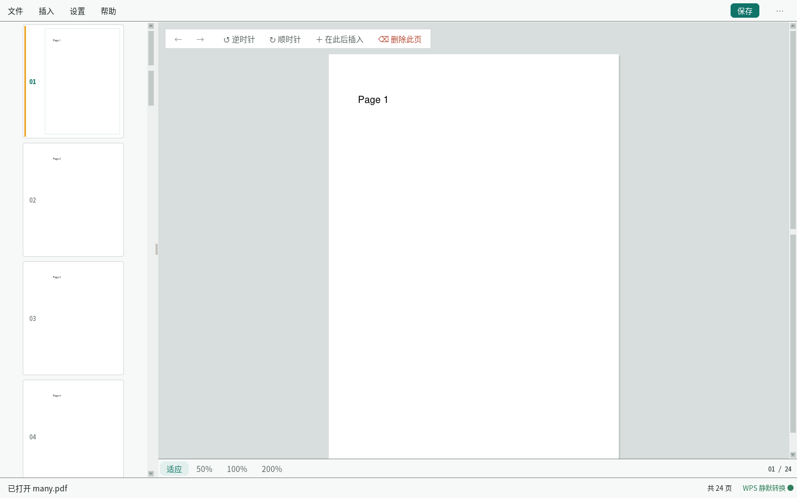

# PDF Editor Assistant

[中文文档](README_CN.md)

**An open-source PDF page manager with a visual GUI** — insert Word / Excel / images
anywhere in a PDF, auto-convert them to PDF pages, and print the result with
per-file print settings.



> 💡 Why this exists: `pdfarranger` can reorder pages, `pdf2pdf` and `qpdf` can merge
> PDFs, but no open-source tool puts *drag-to-reorder*, *insert a Word/Excel/image at a
> given position* and *print with per-file settings* in the same window.

---

## Features

### Page management

- 📄 **Visual page rail** — thumbnail list, drag to reorder (with a drop indicator),
  right-click menu with page-specific actions
- 📝 **Insert any file** — Word (.docx), Excel (.xlsx), PowerPoint (.pptx),
  images (.png/.jpg), text (.txt), PDF → converted to PDF pages → inserted anywhere
  - Select several files at once for a batch insert
  - Choose the position: after the current page / end of document / before a given page
- 🔄 **Page operations** — rotate, delete, move to start, move to end
- ↩️ **Undo / redo** — 5 steps of history, Ctrl+Z / Ctrl+Shift+Z
- 👁️ **Waterfall preview** (default) — all pages stacked vertically, like reading a
  continuous document; drag to scroll, click a page to select it
- 🔍 **Zoom slider** — fit width / fit page, or drag the slider (with -/+ buttons;
  clicking the track jumps straight to that value)
- 🔢 **Page jump** — type a page number and press Enter; ‹ › step page by page
- 🗂️ **Built-in file panel** — pinned places, multi-select, type badges, recent files;
  folders are picked with the same hand-drawn panel
- 💾 **Save** — Save / Save As

### Printing

- 🖨️ **Print the current document** — colour, duplex (long / short edge), page
  orientation (auto / portrait / landscape), copies, paper, scaling, N-up,
  page ranges (`1-5,8,10-`)
  - Prints the **current editing state**: reorder, delete or insert first and the
    printout matches
  - Paper and scaling default to "lay the content out on the selected paper":
    larger pages are reduced, smaller ones are centred at their original size.
    The PDF's own page size (say a 210×140 mm ticket) is never sent to the
    printer as-is, which used to trigger "paper size mismatch" errors
  - Combinations the printer does not support are **blocked with a reason**, never
    silently downgraded (e.g. colour → black and white)
- 🗂️ **Batch printing** — queue many files and set options per file
  - Sort the queue (name / modified time / size / type) or reorder rows with ↑ ↓
  - Start / pause / cancel / retry failed; failed jobs stay isolated and do not
    block the rest
  - Standalone entry point `pdf-print`: no page management, starts faster

### Splitting

- ✂️ **Split a document** (File → Split…) — one PDF into many
  - Three modes: **one file per page** (default) / **every N pages** /
    **by ranges** (`1-3, 4-8, 9-`)
  - Splits the **current editing state**, including unsaved reordering/deletions
  - **Naming rules** with a live preview (what you see is what gets written):
    - original name + number (default): `report_01.pdf`, `report_02.pdf` …
    - custom template: `{name}` `{n}` `{total}` `{page}` `{range}` `{date}` …,
      with start / step / zero-padding and optional prefix & suffix
    - **names from a table**: pick a column from CSV / TXT / Excel (GBK aware,
      sheet and column selectable; short lists fall back to the template)
  - Find & replace (regex), case conversion; illegal characters, over-long
    names and existing files (auto `(2)`) are handled for you
- 🖱️ **Multi-select on thumbnails, extract the selection**
  (`Ctrl+click` to toggle, `Shift+click` for a range, `Esc` to collapse)
  - Right-click → "Extract N selected pages to a new file…": writes the
    selected pages, in order, into one new PDF — the original is untouched;
    the default name reads `report 第3-5页.pdf`
  - Right-click → "Split…": opens the split panel with those pages pre-filled
  - Insert, extract and split sit at the **same level** in the context menu

---

## Quick start

### One-Click Install (Recommended)

```bash
git clone https://github.com/L-df365/pdf-editor-assistant.git
cd pdf-editor-assistant
sudo ./install.sh
```

After installation:
- ✅ "PDF Editor Assistant" appears in the application menu
- ✅ Right-click PDF → Open with → PDF Editor Assistant
- ✅ Command line: `pdf-editor file.pdf`
- ✅ Command line: `pdf-print` (standalone batch printing)

> WPS Office / LibreOffice are not bundled or installed with the app. Selecting a
> missing backend explicitly prompts to install it and restart.
> Printing needs the system package `python3-cups` (the installer adds it).

### Standalone batch printing

```bash
pdf-print                 # opens the batch print window directly
```

It does not load the page management part, so it needs neither PyMuPDF nor the
full app — just tkinter and CUPS.

### Uninstall

```bash
sudo ./uninstall.sh
```

### Run Without Installing

```bash
pip3 install -r requirements.txt
python3 main.py                # the editor
python3 main.py --print        # batch printing
```

---

## Screenshots

| File | What it shows |
|---|---|
| [Workbench](docs/ui/01-工作台.png) | Main window: top bar, page rail, waterfall preview, floating action bar |
| [Context menu](docs/ui/02-右键菜单.png) | Right-click menu with page-specific actions |
| [Page rail](docs/ui/03-页面轨.png) | Thumbnail rail and scrollbar |
| [File panel](docs/ui/04-文件面板.png) | File panel (multi-select + selection count) |
| [Empty state](docs/ui/05-空状态.png) | Empty state before a document is opened |
| [Split panel](docs/ui/06-拆分.png) | Splitting: modes, naming rules, live preview |
| [Multi-select](docs/ui/07-多选提取.png) | Thumbnail multi-select (Ctrl / Shift) and extract |

Design system: [`docs/design-system.md`](docs/design-system.md) ·
Print feature plan: [`docs/print-plan.md`](docs/print-plan.md)

---

## Keyboard shortcuts

| Shortcut | Action |
|---|---|
| `Ctrl+O` / `Ctrl+Shift+O` | Open PDF / open recent file |
| `Ctrl+S` / `Ctrl+Shift+S` | Save / Save As |
| `Ctrl+I` | Insert files after the current page |
| `Ctrl+P` | Print the current document |
| `Ctrl+Z` / `Ctrl+Shift+Z` | Undo / redo |
| `Ctrl+R` / `Ctrl+Shift+R` | Rotate clockwise / counter-clockwise |
| `Ctrl+Shift+↑` / `Ctrl+Shift+↓` | Move to start / end |
| `Ctrl+0` / `Ctrl+1` / `Ctrl+2` | Fit width / fit page / actual size |
| `Ctrl+Shift+I` | Page info |
| `Ctrl+,` | Conversion backend settings |
| `Delete` | Delete the current page |
| `Ctrl+click` / `Shift+click` | Toggle / range-select thumbnails (`Esc` collapses, `Ctrl+A` selects all) |
| `Ctrl+Q` | Quit |

---

## Comparison with existing tools

| Feature | **PDF Editor Assistant** | pdfarranger | pdf2pdf | qpdf | Foxit |
|---------|:-----------------------:|:-----------:|:-------:|:----:|:-----:|
| Visual GUI | ✅ | ✅ | ❌ | ❌ | ✅ |
| Insert Word/Excel | ✅ Auto-convert | ❌ | ❌ | ❌ | ✅ |
| Insert Images | ✅ | ✅ | ❌ | ❌ | ✅ |
| Drag to Reorder | ✅ | ✅ | ❌ | ❌ | ✅ |
| Rotate Pages | ✅ | ✅ | ❌ | ✅ | ✅ |
| Delete Pages | ✅ | ✅ | ❌ | ✅ | ✅ |
| Per-file print settings | ✅ | ❌ | ❌ | ❌ | ✅ |
| Batch print queue | ✅ | ❌ | ❌ | ❌ | ✅ |
| Split with name list | ✅ | ❌ | ❌ | ✅ CLI only | ✅ |
| Multi-select + extract | ✅ | ✅ | ❌ | ❌ | ✅ |
| Fit-to-window Preview | ✅ | ❌ | ❌ | ❌ | ✅ |
| Open Source | ✅ | ✅ | ✅ | ✅ | ❌ |
| Install Size | ~61MB | ~5MB | ~1MB | ~2MB | ~200MB |

> Size breakdown: 1.5MB for the app itself, 48MB PyMuPDF, 7MB Pillow, 4MB openpyxl.
> WPS / LibreOffice are not included (installed on demand).

---

## Conversion backends

The conversion backend is pluggable behind a single interface:

```python
output_path = backend.convert_to_pdf(input_path)
```

| Name | Description |
|------|-------------|
| `wps` | Local WPS Office via pywpsrpc. Silent conversion (`Visible = False`, `WithWindow = False`) on an isolated Xvfb display — the splash screen and windows never appear on your desktop |
| `libreoffice` | LibreOffice headless conversion |

The app itself only contains the UI and PDF logic; WPS/LibreOffice are not
packaged with it. On startup the app checks the local environment:

- **WPS installed**: automatically installs the missing `pywpsrpc` / `xvfb`
  support.
- **LibreOffice installed**: used directly, no extra components needed.
- **Neither installed**: shows two buttons, "Install WPS Office" and "Install
  LibreOffice", which open the system software store and copy the search term.
  Restart the app after installation.
- Selecting a missing backend manually under Settings → Conversion Backend also
  offers to install it.

Select the backend (highest priority first):

1. GUI: Settings → Conversion Backend
2. CLI: `python3 main.py --backend wps file.pdf`
3. Environment: `PDF_EDIT_BACKEND=wps|libreoffice|auto`
4. Default `auto`: prefer WPS (pywpsrpc), fall back to LibreOffice

The WPS backend requires a local WPS Office installation and `pywpsrpc`.
There is no official aarch64 wheel, so the app ships a prebuilt one and
installs it offline (`pip --no-index --no-deps`); if pip is too old or not
installed at all, the wheel is unpacked straight into the user site-packages —
no network, no compiler, no Qt5 headers. Source builds are only attempted when
the prebuilt wheel does not match the local Python / architecture.
Conversions run on an isolated Xvfb display, so the WPS splash screen never
flashes on the desktop.

---

## How printing works

Printing goes through CUPS / IPP. Every print option is a **job-level** IPP
attribute:

| Option in the UI | CUPS attribute |
|---|---|
| Colour (colour / monochrome) | `print-color-mode` |
| Duplex (one-sided / long-edge / short-edge) | `sides` |
| Copies | `copies` |
| Paper | `media` |
| Scaling | `print-scaling` (defaults to `auto` so content lands on the paper) |
| Orientation (auto / portrait / landscape) | `orientation-requested` |
| N-up | `number-up` + `number-up-layout` |
| Page ranges | `page-ranges` |

So "set options per file" means splitting into several jobs; consecutive files
with identical options can be merged into one job. Before submitting, the app
checks what the printer actually supports (`sides-supported`,
`print-color-mode-supported`, `media-supported`, `number-up-supported`,
`orientation-requested-supported`) and blocks unsupported combinations with an
explanation.

Monochrome printing does not rely on CUPS' Ghostscript renderer. Tickets,
invoices and ID cards often reference KaiTi/SimSun as CID fonts without
embedding them; when Ghostscript substitutes a font, entire runs of digits and
letters disappear (and QR codes get mangled). The app therefore converts to
grayscale itself: `pdftocairo` embeds the system fonts, Ghostscript only
converts colours, and Poppler produces the final PostScript. This needs
`pdftocairo` (poppler-utils) and `gs` on the machine; the print panel says so
when either is missing.

`core/print_core/` is the single implementation of printing — no tkinter, no
PyMuPDF. Printing the open document (`print_single`) and batch printing
(`print_batch`) share the same option mapping, conversion and error handling.

---

## Architecture

```
pdf-editor-assistant/
├── main.py              # Entry point (--print opens batch printing directly)
├── install.sh           # One-click installer
├── uninstall.sh         # Uninstaller
├── requirements.txt     # Python dependencies (PyMuPDF / Pillow / openpyxl)
├── requirements-wps.txt # Optional: WPS backend dependency
├── core/                # UI-independent
│   ├── converter.py     # Switchable backend facade
│   ├── settings.py      # Persist the selected backend and recent files
│   ├── formats.py       # Supported file types (single source of truth)
│   ├── backends/        # Backend implementations
│   │   ├── base.py      # Common interface
│   │   ├── installer.py # On-demand WPS / LibreOffice install
│   │   ├── wps.py       # Silent WPS backend
│   │   ├── wps_worker.py# Isolated WPS conversion process
│   │   └── libreoffice.py
│   ├── pdf_document.py  # PDF operations, undo stack (PyMuPDF)
│   ├── splitter.py      # Split: per page / every N pages / by ranges
│   ├── naming.py        # Naming rules: templates, table lists, find & replace
│   └── print_core/      # Printing core (no tkinter / PyMuPDF)
│       ├── jobs.py      #   PrintJob / PrintOptions
│       ├── ranges.py    #   Page range parsing
│       ├── convert.py   #   Turn a job into a printable PDF
│       ├── backend.py   #   CUPS: capabilities, submit, query, cancel
│       └── queue.py     #   Batch queue
├── gui/                 # UI layer (tkinter + self-drawn widgets)
│   ├── main_window.py   # Main window, top bar, menus
│   ├── theme.py         # Design tokens and ttk styles
│   ├── widgets.py       # Rounded buttons, segmented control, chips, cards
│   ├── draw.py          # Anti-aliased rounded-corner rendering
│   ├── menu.py          # Popover menus
│   ├── feedback.py      # Toast / confirm / error / info panels
│   ├── thumbnail_panel.py # Page rail: thumbnails, drag-drop, context menu
│   ├── preview_panel.py # Preview: stage, zoom, floating action bar
│   ├── file_sheet.py    # File panel (files / folders)
│   ├── insert_sheet.py  # Insert-position panel
│   ├── print_sheet.py   # Print the current document
│   ├── print_options.py # Print options form (shared)
│   ├── batch_print_window.py # Batch print window
│   ├── split_sheet.py   # Split panel (mode + naming + live preview)
│   ├── backend_dialog.py# Conversion backend settings
│   ├── empty_state.py   # Empty state
│   └── version.py       # Version number
├── docs/
│   ├── design-system.md # Design system
│   ├── print-plan.md    # Print feature plan
│   └── ui/              # Screenshots
└── tools/uitest.py      # UI self-test: synthesised real mouse events (215 checks)
```

---

## Tech stack

| Component | Technology |
|-----------|------------|
| GUI | tkinter (ships with Python) + PIL for anti-aliased corners and shadows |
| PDF Rendering | PyMuPDF |
| File Conversion | Local WPS Office (pywpsrpc) / LibreOffice headless (on demand) |
| Printing | CUPS / IPP (`python3-cups`) |
| Image Processing | Pillow |

No third-party GUI framework is used; the only runtime dependencies are PyMuPDF
and Pillow.

---

## Roadmap

- [x] Batch insert multiple files (multi-select in the file panel)
- [x] Undo / redo
- [x] Waterfall preview + zoom slider + page jump
- [x] Print the current document (colour, duplex, copies, paper, scaling, N-up, page ranges)
- [x] Batch printing (multi-file queue, per-file overrides, pause/cancel/retry, failure isolation)
- [ ] Automatic job merge/split, print templates, print history
- [ ] Page cropping
- [ ] Watermark/stamp support
- [ ] Page numbering
- [x] PDF split (per page / every N pages / ranges, name lists)
- [x] Multi-select thumbnails and extract the selection into a new PDF
- [ ] PDF merge (combine several files into one)
- [ ] Cross-platform packaging (PyInstaller)
- [ ] Dark mode

---

## Development

```bash
xvfb-run -a python3 tools/uitest.py      # UI self-test (215 checks, no display needed)
```

The self-test drives the real code paths with synthesised mouse events
(click / drag / hover / right-click) and never touches a real printer
(the CUPS connection is faked).

---

## Contributing

Contributions are welcome! Please feel free to submit a Pull Request.

1. Fork the repository
2. Create your feature branch (`git checkout -b feature/amazing-feature`)
3. Commit your changes (`git commit -m 'Add amazing feature'`)
4. Push to the branch (`git push origin feature/amazing-feature`)
5. Open a Pull Request

---

## License

MIT License — see [LICENSE](LICENSE) for details.

---

## Acknowledgments

- [PyMuPDF](https://pymupdf.readthedocs.io/) — PDF rendering and manipulation
- [WPS Office / pywpsrpc](https://github.com/timxx/pywpsrpc) — Silent local document conversion
- [LibreOffice](https://www.libreoffice.org/) — Fallback document conversion engine
