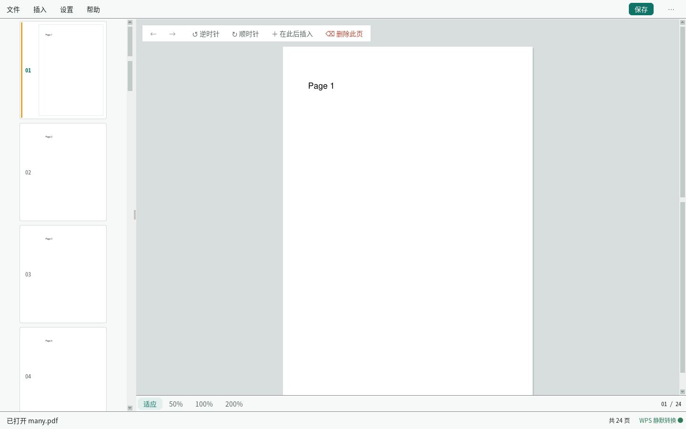

# PDF 内嵌编辑助手

**开源的带可视化界面的 PDF 页面管理器** — 在任意位置插入 Word/Excel/图片，自动转换为 PDF 页面，实时预览。

> 💡 为什么要做这个：pdfarranger 能拖拽排序，pdf2pdf、qpdf 能合并 PDF，但没有一个
> 开源工具能把「拖拽排序」和「在指定位置插入 Word/Excel/图片」放在同一个界面里做。
> 这个工具补的就是这一块。



## 功能特性

- 📄 **可视化页面管理** — 页面轨缩略图，拖拽排序（带落点指示线）
- 📝 **插入任意文件** — Word (.docx)、Excel (.xlsx)、图片 (.png/.jpg) → 自动转换为 PDF → 插入到任意位置
  - 支持**一次选多个文件**批量插入，插入位置可选：当前页之后 / 文末 / 指定页之前
- 🔄 **页面操作** — 旋转、删除、移动页面
- ↩️ **撤销 / 重做** — 5 步历史，快捷键 Ctrl+Z / Ctrl+Shift+Z
- 👁️ **实时预览** — 适应窗口 / 50% / 100% / 200% 缩放
- 🗂️ **自绘文件面板** — 常用位置置顶、多选、类型徽标、最近文件
- 🖨️ **打印** — 打印当前文档：颜色、单双面（长边/短边）、份数、纸张、缩放、N-up、页码范围
  （打印机不支持的组合会明确拦下，不静默降级）
- 🗂️ **批量打印** — 一批文件排队打印，每个文件可以单独设参数；
  独立入口 `pdf-print`（不启动页面管理，启动更快），主程序里也能打开同一套窗口
- 💾 **保存** — 保存 / 另存为

## 快速开始

### 一键安装（推荐）

```bash
git clone https://github.com/L-df365/pdf-editor-assistant.git
cd pdf-editor-assistant
sudo ./install.sh
```

安装完成后：
- ✅ 开始菜单出现「PDF 内嵌编辑助手」
- ✅ 右键 PDF 文件 → 打开方式 → PDF 内嵌编辑助手
- ✅ 命令行运行 `pdf-editor 文件.pdf`

> WPS Office / LibreOffice 不随应用安装。首次在应用中选择未安装的后端时，
> 会弹出安装提示；安装完成后可立即重启应用生效。

### 独立批量打印

```bash
pdf-print                 # 直接开批量打印窗口
```

### 卸载

```bash
sudo ./uninstall.sh
```

### 手动运行（不安装）

```bash
pip3 install -r requirements.txt
python3 main.py
```

## 与其他工具对比

| 功能 | **PDF 内嵌编辑助手** | pdfarranger | pdf2pdf | qpdf | 福昕 |
|------|:-------------------:|:-----------:|:-------:|:----:|:----:|
| 可视化界面 | ✅ | ✅ | ❌ | ❌ | ✅ |
| 插入 Word/Excel | ✅ 自动转换 | ❌ | ❌ | ❌ | ✅ |
| 插入图片 | ✅ | ✅ | ❌ | ❌ | ✅ |
| 拖拽排序 | ✅ | ✅ | ❌ | ❌ | ✅ |
| 旋转页面 | ✅ | ✅ | ❌ | ✅ | ✅ |
| 删除页面 | ✅ | ✅ | ❌ | ✅ | ✅ |
| 适应窗口预览 | ✅ | ❌ | ❌ | ❌ | ✅ |
| 开源免费 | ✅ | ✅ | ✅ | ✅ | ❌ |
| 安装体积 | ~56MB | ~5MB | ~1MB | ~2MB | ~200MB |

## 为什么不用福昕/WPS？

1. **隐私安全** — 文件不会离开你的电脑
2. **完全免费** — 无授权费，无订阅
3. **轻量级** — 应用本体约 1MB（含依赖约 56MB）vs 200MB+
4. **可自动化** — 可集成到工作流中
5. **可定制** — 根据需求修改

## 转换后端

文件转换后端可替换，统一接口：

```python
output_path = backend.convert_to_pdf(input_path)
```

可用后端（不随应用打包，优先调用本机已安装的程序）：

| 名称 | 说明 |
|------|------|
| `wps` | 调用本机 WPS Office（pywpsrpc），静默转换：`Visible = False`、`WithWindow = False`，并在独立的 Xvfb 虚拟屏幕中运行，启动画面和窗口不会出现在桌面上 |
| `libreoffice` | LibreOffice headless 转换 |

应用本身只包含界面和 PDF 处理逻辑，不包含 WPS/LibreOffice。启动时会
自动检测本机环境：

- 已安装 **WPS**：自动补齐 `pywpsrpc`、`xvfb` 等 WPS 转换支持。
- 已安装 **LibreOffice**：直接使用，无需额外组件。
- 两者都未安装：弹出选择框，提供「安装 WPS Office」和「安装 LibreOffice」
  两个按钮，点击后打开系统软件商店并复制搜索词，安装完成后重启应用即可。
- 在「设置 → 转换后端」中手动选择未安装的后端时，也会提示安装。

选择方式（优先级从高到低）：

1. 图形界面「设置 → 转换后端」
2. 命令行 `python3 main.py --backend wps file.pdf`
3. 环境变量 `PDF_EDIT_BACKEND=wps|libreoffice|auto`
4. 默认 `auto`：优先 WPS(pywpsrpc)，不可用时回退 LibreOffice

WPS 后端依赖本机 WPS Office 和 `pywpsrpc`。aarch64 平台没有官方 wheel，
源码编译可能较慢；应用会尝试自动安装，失败时给出提示和项目链接。
转换会自动使用独立的 Xvfb 虚拟屏幕，因此 WPS 的启动动画不会在桌面上闪现。

## 项目结构

```
pdf-editor-assistant/
├── main.py              # 程序入口
├── install.sh           # 一键安装脚本
├── uninstall.sh         # 卸载脚本
├── requirements.txt     # Python 依赖（只有 PyMuPDF 和 Pillow）
├── requirements-wps.txt # 可选：WPS 后端依赖
├── core/                # 与界面无关
│   ├── converter.py     # 转换后端门面（可切换）
│   ├── settings.py      # 记住所选后端与最近文件
│   ├── formats.py       # 支持的文件类型（唯一来源）
│   ├── backends/        # 后端实现
│   │   ├── base.py      # 统一接口
│   │   ├── installer.py # 按需安装 WPS / LibreOffice
│   │   ├── wps.py       # WPS 静默后端
│   │   ├── wps_worker.py# WPS 独立转换进程
│   │   └── libreoffice.py
│   └── pdf_document.py  # PDF 操作、撤销栈（PyMuPDF）
├── gui/                 # 界面层（Tkinter + 自绘组件）
│   ├── main_window.py   # 主窗口、顶栏、菜单
│   ├── theme.py         # 设计令牌与 ttk 样式
│   ├── widgets.py       # 圆角按钮、色块标签、圆角卡片
│   ├── draw.py          # 抗锯齿圆角渲染
│   ├── menu.py          # 浮层菜单
│   ├── feedback.py      # 轻提示 / 确认 / 错误 / 信息面板
│   ├── thumbnail_panel.py # 页面轨：缩略图、拖拽排序、右键菜单
│   ├── preview_panel.py # 预览：台面、缩放、浮动动作条
│   ├── file_sheet.py    # 文件选择面板
│   ├── insert_sheet.py  # 插入位置面板
│   ├── backend_dialog.py# 转换后端设置
│   └── empty_state.py   # 空状态
├── docs/
│   ├── design-system.md # 设计系统
│   └── ui/              # 界面截图
└── tools/uitest.py      # 界面自测：合成真实鼠标事件
```

## 技术栈

| 组件 | 技术 |
|------|------|
| 界面 | tkinter（Python 自带）+ PIL 抗锯齿自绘圆角/阴影 |
| PDF 渲染 | PyMuPDF |
| 文件转换 | 本机 WPS Office (pywpsrpc) / LibreOffice headless（按需安装） |
| 图片处理 | Pillow |

界面不使用任何第三方 GUI 框架，运行时依赖只有 PyMuPDF 与 Pillow 两个。

## 界面

| 截图 | 说明 |
|---|---|
| [工作台](docs/ui/01-工作台.png) | 主界面：顶栏 + 页面轨 + 台面 + 浮动动作条 |
| [右键菜单](docs/ui/02-右键菜单.png) | 页面右键菜单（按当前页给出上下文操作） |
| [页面轨](docs/ui/03-页面轨.png) | 页面轨与滚动条 |
| [文件面板](docs/ui/04-文件面板.png) | 文件选择面板（多选 + 已选计数） |
| [空状态](docs/ui/05-空状态.png) | 未打开文档时的空状态 |

## 路线图

- [x] 批量插入多个文件（文件面板多选）
- [x] 撤销 / 重做
- [x] 打印当前文档（颜色、单双面、份数、纸张、缩放、N-up、页码范围）
- [x] 批量打印（多文件队列、逐文件覆盖、暂停/取消/重试、失败隔离）
- [ ] 打印任务自动合并与拆分、打印模板与历史（方案见 `docs/print-plan.md`）
- [ ] 页面裁剪
- [ ] 水印/印章支持
- [ ] 页码编号
- [ ] PDF 合并/拆分
- [ ] 跨平台打包 (PyInstaller)
- [ ] 暗色模式

## 贡献

欢迎贡献代码！请提交 Pull Request。

1. Fork 本仓库
2. 创建功能分支 (`git checkout -b feature/amazing-feature`)
3. 提交更改 (`git commit -m 'Add amazing feature'`)
4. 推送到分支 (`git push origin feature/amazing-feature`)
5. 创建 Pull Request

## 许可证

MIT License — 详见 [LICENSE](LICENSE)

## 致谢

- [PyMuPDF](https://pymupdf.readthedocs.io/) — PDF 渲染和操作
- [WPS Office / pywpsrpc](https://github.com/timxx/pywpsrpc) — 本机静默文档转换
- [LibreOffice](https://www.libreoffice.org/) — 备用文档转换引擎
